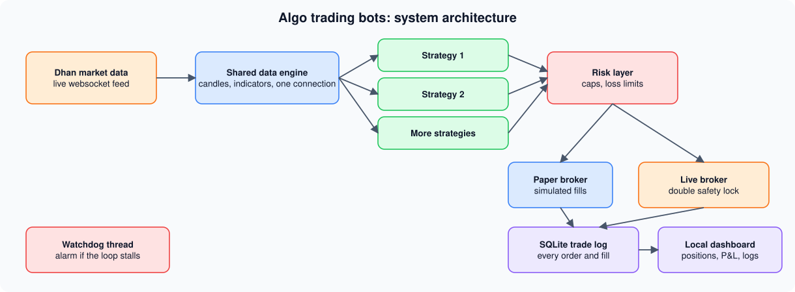
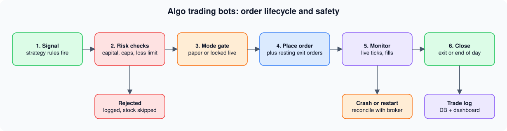

**I design, build and operate automated trading systems from market data to risk controls.**
This page shows how they are engineered. Strategy rules, parameters, credentials and trade data are not published.

---

## At a glance

| | |
|---|---|
| **Systems built** | 3 (a live capable options bot, a multi strategy paper platform, a research pipeline) |
| **Strategies running side by side** | 25 in a single process |
| **Market data connections** | 1 shared websocket for all of them |
| **Modes** | Paper trading and live trading, separated by a double safety lock |
| **Safety nets** | Risk caps, loss limit, watchdog, restart reconciliation |
| **Operated** | Through real market sessions |

## System architecture

## Order lifecycle and safety

Every order passes through the same gates, from signal to close.

---

## Explore each system

<b>1. Intraday options bot</b> (click to expand)

 

- Paper and live modes, with a double safety lock before any real order can be placed
- Resting exit orders placed on the exchange instead of relying on polling
- Live websocket price feed with automatic recovery
- Daily risk caps and loss limits
- Watchdog thread that raises an alarm if the main loop stalls
- Safe to restart: reconciles open positions with the broker after a crash
- Local web dashboard for positions, P&L and logs

<b>2. Multi strategy paper trading platform</b> (click to expand)

 

- 25 independent strategies run in **one process** on a single shared websocket connection
- Each strategy has its own capital, trade log and rules
- Paper only by design: no live order path exists in the code
- Daily start, monitor and square off routine with a full operations handbook

<b>3. Quantitative research pipeline</b> (click to expand)

 

- Systematic search for robust intraday edges on second level data
- Strict workflow against overfitting: train, validation and test splits, walk forward testing, pessimistic fill assumptions
- Results are judged on unseen data only

---

## Engineering war stories

<b>The silent order rejection</b>

 

NSE option prices must be exact multiples of the tick size. A rounding bug produced invalid prices, and the exchange rejected the orders silently while the bot logged success. Found through a real rejection, fixed with rounding that respects the tick size.

<b>The healthy looking dashboard that hid a frozen bot</b>

 

The dashboard runs on its own thread, so it kept responding while the trading loop was frozen. This led to a watchdog that raises an alarm within about two minutes if the loop stops beating.

<b>The IPv4 and IPv6 mix up</b>

 

Adding a websocket made the machine connect over IPv6, which broke the broker's IP whitelist for order placement. Fixed by forcing a single IP stack at the socket level, covering every library at once.

<b>The orphaned position</b>

 

A failed exit used to clear the bot's own tracking, leaving a real position that nothing watched. Exits now only clear tracking after confirmed success, and the end of day square off retries and shouts loudly if anything stays open.

<b>The ledger that drifted from reality</b>

 

A purely simulated capital ledger can disagree with the broker's real balance. Lesson learned: reconcile against the broker, and credit the ledger whenever a trade is closed by hand.

---

## Tech stack

`Python` · `asyncio` · `websockets` · `pandas` · `SQLite` · `Flask` · `Dhan API v2`

> **Disclaimer:** Educational and personal project. Not investment advice. Trading involves risk.
